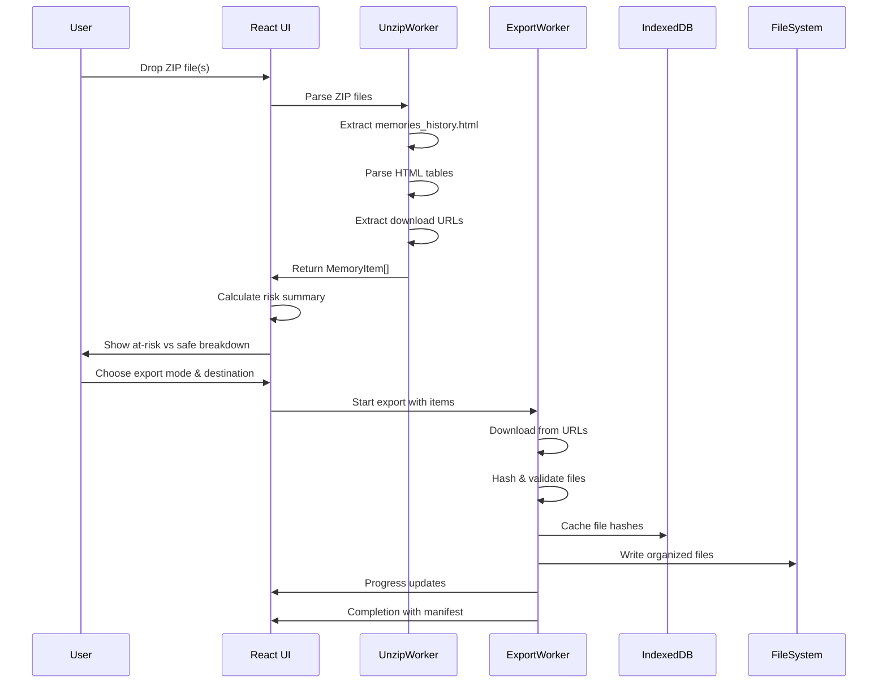
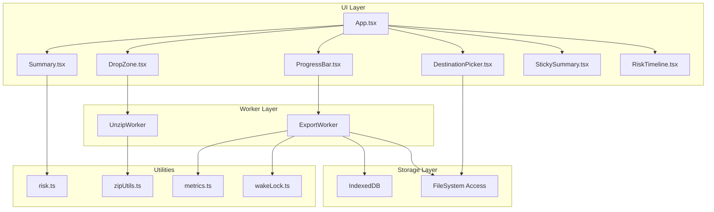

# Architecture Overview

## System Flow



## Component Architecture



## Data Models

### MemoryItem
```typescript
interface MemoryItem {
  id: string;                    // Unique identifier
  createdAtIso: string;         // ISO timestamp
  zipPath: string;              // Download URL or ZIP path
  sizeBytes?: number;           // File size (filled during download)
  mediaType: 'photo' | 'video'; // Media type
  originalName: string;         // Original filename
  sha256?: string;              // Hash for deduplication
}
```

### RiskSummary
```typescript
interface RiskSummary {
  totalItems: number;
  totalSizeBytes: number;
  safeItems: number;
  atRiskItems: number;
  firstAtRiskDate?: string;     // Oldest at-risk item
  safeFloorGiB: number;         // 5 GiB threshold
  atRiskSizeBytes: number;      // Size of at-risk items
}
```

### ExportProgress
```typescript
interface ExportProgress {
  percent: number;
  copiedCount: number;
  skippedCount: number;
  failedCount: number;
  currentFile?: string;
  status?: string;
  speedMBps?: number;
  eta?: string;
}
```

### Manifest
```typescript
interface Manifest {
  version: string;
  exportedAt: string;
  mode: 'at-risk' | 'all';
  destStrategy: 'fs-access' | 'download-zip';
  stats: {
    copiedCount: number;
    skippedCount: number;
    failedCount: number;
    totalItems: number;
  };
  files: Array<{
    id: string;
    path: string;
    sizeBytes: number;
    sha256: string;
    copiedAt: string;
  }>;
}
```

## Key Design Decisions

### 1. Worker-Based Architecture
- **UnzipWorker**: Handles ZIP parsing and HTML extraction
- **ExportWorker**: Manages file downloads and writes
- **Benefits**: Non-blocking UI, better error isolation, parallel processing

### 2. Streaming File Processing
- **Memory Efficiency**: Process large files without loading entirely into memory
- **Progress Tracking**: Real-time progress updates during long operations
- **Resume Capability**: Can pause/resume exports without losing progress

### 3. Idempotent Operations
- **Hash-Based Deduplication**: SHA-256 hashes prevent duplicate downloads
- **IndexedDB Cache**: Persistent storage of file metadata and hashes
- **Atomic Writes**: File system operations are atomic to prevent corruption

### 4. Graceful Degradation
- **File System Access**: Primary method with download ZIP fallback
- **Browser Compatibility**: Progressive enhancement for different capabilities
- **Error Recovery**: Retry mechanisms and user-friendly error messages

## Performance Considerations

### Memory Management
- **Streaming**: Large files processed in chunks
- **Worker Isolation**: Heavy processing in separate threads
- **Garbage Collection**: Explicit cleanup of large objects

### Network Optimization
- **Concurrent Downloads**: Bounded concurrency to avoid overwhelming servers
- **Retry Logic**: Exponential backoff for failed requests
- **Timeout Handling**: 30-second timeouts prevent hanging requests

### File System Efficiency
- **Batch Operations**: Group file system operations where possible
- **Directory Structure**: Organized by date for easy browsing
- **Atomic Writes**: Prevent partial file corruption
